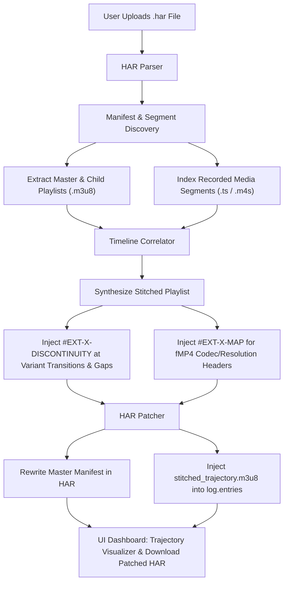

# HAR Video Stream Stitcher

An in-browser and Node.js tool to repair ABR (Adaptive Bitrate) transition freezes in HTTP Archive (`.har`) recordings and synthesize continuous HLS streams for `har-player`.

---

## 1. Technical Diagnosis: Why `har-player` Gets Stuck at Second 4

### The Scenario
1. **Live Recording**: During the recorded session, the browser started playback at **720p** (downloading Segment 0 and Segment 1, covering seconds 0–4).
2. **ABR Upswitch**: Around second 4, network bandwidth estimation allowed the player's ABR algorithm to switch to **1080p** (downloading Segment 2, Segment 3, etc.).
3. **HAR Contents**:
   - Master Manifest (`master.m3u8`) & Child Variant Playlists (`720p.m3u8`, `1080p.m3u8`).
   - 720p Segments: **Index 0 and 1 ONLY** (Segment 2+ was never requested).
   - 1080p Segments: **Index 2, 3... ONLY** (Segments 0 and 1 were never requested).

### Why the Player Engine Gets Stuck and Cannot Switch to 1080p
1. **ABR Assumes Omnipresent Segments**: Player engines (HLS.js, Shaka Player, Bitmovin, AVPlayer) assume every declared variant playlist has all media segments available at every timeline index.
2. **HTTP 404 is a Fatal Fragment Error, Not an ABR Trigger**:
   - In `har-player`, requests are served from recorded HAR entries.
   - When the player reaches second 4 on the 720p track, it attempts to fetch `720p_segment_2.ts`.
   - Because `720p_segment_2.ts` is absent in the HAR, `har-player` responds with **HTTP 404 (Not Found)**.
   - HLS.js treats this as a `FRAG_LOAD_ERROR` and enters an exponential retry loop on the current track instead of querying other variant playlists. When retries exhaust, playback stalls indefinitely.
3. **Naïve Switching Fails**:
   - If the player engine attempted to switch to 1080p after the error, seeking backwards would attempt to fetch 1080p segments 0 and 1—which also return HTTP 404s!
   - Without `#EXT-X-DISCONTINUITY` and a single continuous timeline, switching variants mid-playback causes decoder timestamp mismatches and buffer append errors (`Buffer Append Failure`).

---

## 2. Solution: Stream Stitching & Manifest Rewriting



### Architectural Highlights
- **Single Stitched Stream in Master Manifest**: The master manifest is rewritten to serve only the stitched trajectory, eliminating ABR switching attempts to missing variants.
- **Playlist-Driven Sequence Indexing**: Correlates segments across variants using `#EXT-X-MEDIA-SEQUENCE` and `#EXTINF` duration offsets.
- **Gap Handling**: Missing segment indices across all variants are skipped and bridged with `#EXT-X-DISCONTINUITY`.
- **fMP4 Support**: Auto-detects `#EXT-X-MAP` headers and injects target variant initialization segments alongside `#EXT-X-DISCONTINUITY`.
- **Zero-Build Vanilla Web App**: Standalone HTML/CSS/JS with no npm build or bundler required.

---

## 3. Project Structure

```
har-stitcher-app/
├── index.html         # Responsive dashboard UI with drag-and-drop & timeline visualizer
├── styles.css         # Modern dark-themed styling, chips, badges, and code diff view
├── stitcher.js        # Universal core engine (Browser & Node.js compatible)
├── app.js             # UI controller, state management, file export & sample generator
├── sample-test.js     # Comprehensive Node.js verification test suite
└── README.md          # Implementation plan, diagnosis, and usage documentation
```

---

## 4. Getting Started

### Option A: In the Browser (Zero Build)
1. Open `index.html` in any modern web browser:
   ```bash
   # Or using a simple local server:
   npx serve .
   # or
   python3 -m http.server 8080
   ```
2. Drag and drop your `.har` file onto the drop zone (or click **"Load 720p ➔ 1080p Sample HAR"** to test immediately).
3. Inspect the Trajectory Timeline, Discontinuities, and Manifest Diff.
4. Click **"Download Patched .har"** and load it directly into `har-player`!

### Option B: Node.js Test Suite & Scripting
Run the unit test suite to verify timeline correlation, discontinuity injection, and HAR patching:
```bash
node sample-test.js
```

### Programmatic Usage via JavaScript / Node:
```javascript
const fs = require('fs');
const HarStitcher = require('./stitcher.js');

const rawHar = JSON.parse(fs.readFileSync('recording.har', 'utf8'));

// Run full pipeline: parse -> analyze -> timeline -> synthesize -> patch
const result = HarStitcher.processHar(rawHar);

console.log('Total playable duration:', result.timelineResult.metrics.totalDuration);
console.log('Discontinuities inserted:', result.timelineResult.metrics.transitionsCount);

// Save patched HAR
fs.writeFileSync('recording.stitched.har', JSON.stringify(result.patchResult.patchedHar, null, 2));
```

---

## 5. Algorithmic Correctness & Verification

The included `sample-test.js` tests:
- [x] Extraction of manifests (`master.m3u8`, `720p.m3u8`, `1080p.m3u8`) and media segments.
- [x] Timeline correlation across sequence indices:
  - Sequence 0: 720p (`seg_0.ts`)
  - Sequence 1: 720p (`seg_1.ts`)
  - Sequence 2: 1080p (`seg_2.ts`) [Transition point]
  - Sequence 3: 1080p (`seg_3.ts`)
- [x] `#EXT-X-DISCONTINUITY` insertion immediately before the variant transition at index 2.
- [x] Master manifest rewriting to point solely to `stitched_trajectory.m3u8`.
- [x] Injection of HTTP 200 `stitched_trajectory.m3u8` into `log.entries`.
- [x] Gap detection and skip with discontinuity.
- [x] fMP4 `#EXT-X-MAP` initialization fragment switching.

